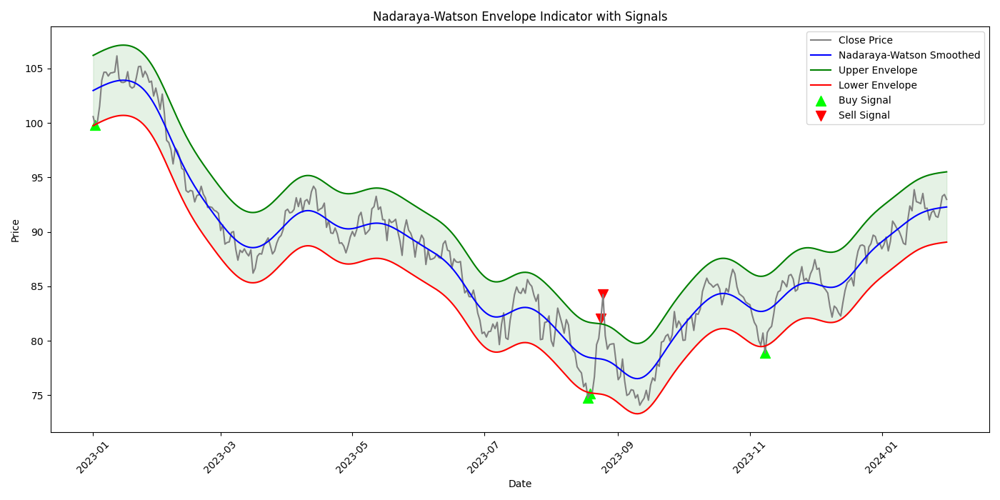

# Nadaraya–Watson envelope visualization

Historical Python analysis exercise using NumPy, pandas, and Matplotlib. The included generator creates a **synthetic random walk**; this repository does not execute trades, connect to an exchange, or demonstrate returns.



## Run locally

```bash
git clone https://github.com/rcc00n/CryptoBot.git
cd CryptoBot
python -m venv .venv
# Activate the environment for your shell.
pip install -r requirements.txt
python -m unittest discover -s tests -v
```

`python main.py` generates new synthetic data and writes `data.csv` and `image.png` in the current directory, replacing files with those names. Run it in a disposable working directory if you want to preserve the checked-in examples. To plot an existing CSV without regenerating it, import and call `plot.plot()` with `Date` and `Close` columns in the working-directory `data.csv`.

## What the chart means

`logic.py` applies an all-samples Nadaraya–Watson smoother and an absolute-deviation envelope. Each point uses observations on both sides, including later observations: **the calculation is retrospective and repaints**. The plotted crossing markers are descriptive chart annotations, not an out-of-sample strategy or backtest. No market forecast, execution, profitability, or investment-suitability claim is made.

The implementation builds an N × N weight matrix; large datasets require a different approach. Tests cover constant-series invariance, envelope ordering, kernel symmetry, and crossing boundaries on synthetic inputs. Generated bytecode has been removed; original source, sample media/data, and the GPL-3.0 licence remain.
